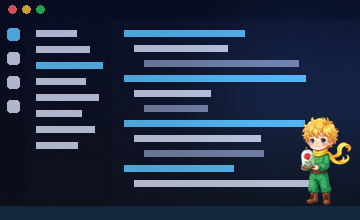
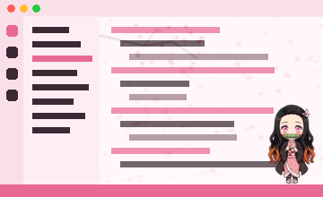
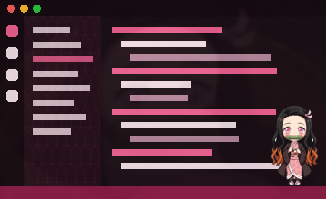
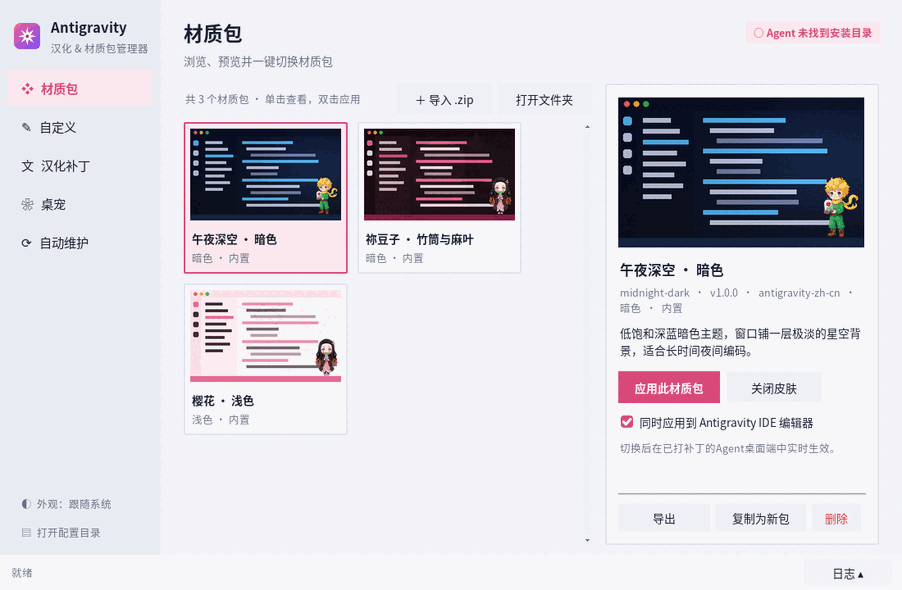
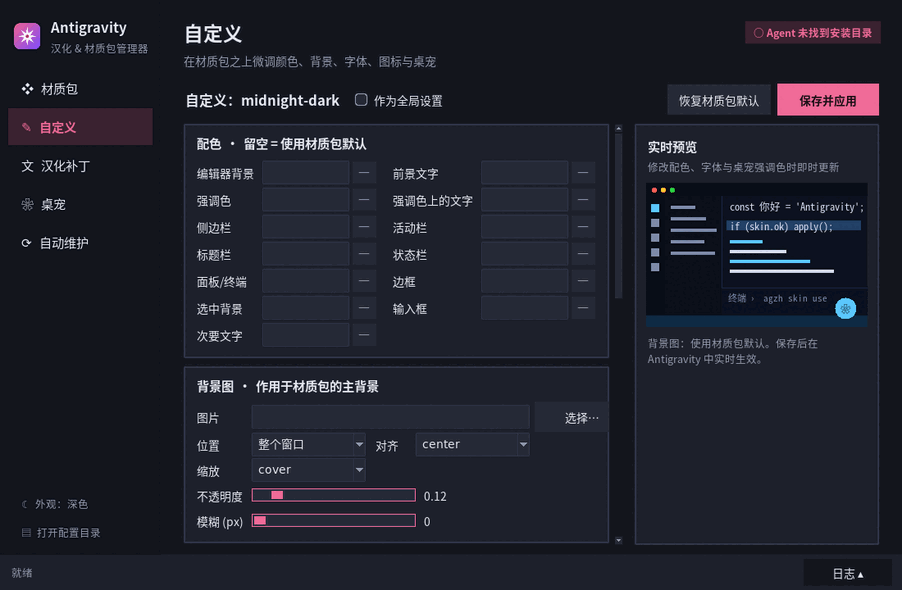

<div align="center">

# Antigravity 中文汉化 · 材质包 · 桌宠 · 一体化管理器

**antigravity-zh-cn** —— 为 Google Antigravity 智能体桌面端与配套 IDE 打造的本地中文化与个性化工具箱

[](https://github.com/qts2218346424-cyber/antigravity-zh-cn/actions/workflows/build-app.yml)
[](LICENSE)
[](resources/version.json)
[](resources/version.json)


简体中文 · 繁體中文（台灣 / 香港） · 材质包皮肤系统 · 祢豆子 / 小王子桌宠 · 官方更新后自动重新套用

[快速开始](#-快速开始) · [一体化管理器](#-一体化管理器) · [命令行](#-命令行参考-agzhpy) · [材质包](#-材质包格式速览) · [常见问题](#-常见问题与排错) · [English](#english)

</div>

---

> [!IMPORTANT]
> 本项目为**非官方**社区工具，与 Google 无任何关联。它会修改本机 Antigravity 安装目录中的 `app.asar` 与 IDE 工作台样式文件；首次安装会自动备份原版，随时可一键还原。

## ✨ 功能一览

| 模块 | 说明 |
| :--- | :--- |
| 🈶 **界面汉化** | 支持 `zh-CN` / `zh-TW` / `zh-HK`。Electron 主进程（菜单、托盘、更新提示）+ 渲染层（会话、工件面板、设置、模型选择、Diff 等）双层汉化；约 4000 条界面词条 + 800 余条动态正则规则。代码编辑器、终端、`<pre>/<code>`、输入框与对话正文均被排除，不会改动代码或你输入的内容。 |
| 🎨 **材质包皮肤系统** | 一个材质包同时控制**配色、背景图（整窗 / 编辑区 / 侧边栏 / 面板 / 终端 / 聊天区，可调透明度与模糊）、字体、图标、桌宠外观、追加 CSS**；支持个人覆盖层、`.zip` 导入导出与安全校验。Agent 桌面端切换**实时生效**，IDE 端自动修正校验和。 |
| 🐾 **桌宠：祢豆子 / 小王子** | Agent 窗口内桌宠（可缩放、可关闭）；Windows 上还可启动**独立桌面透明桌宠**（可拖拽、系统托盘管理、QQ 音乐状态联动）。外观可由材质包调整，不改动动作代码。 |
| 🎬 **启动动画** | 《鬼灭之刃》主题启动画面，可选 `tanjiro` / `zenitsu` / `inosuke` / `nezuko` / `all`。 |
| 🧰 **一体化管理器** | 基于 Python 自带 tkinter 的轻量图形界面（浅色 / 深色跟随系统），五个功能页：材质包、自定义、汉化补丁、桌宠、自动维护；可由 GitHub Actions 打包为单文件 `AntigravityZhCN.exe`。 |
| ♻️ **更新后自动重新套用** | 记录补丁后的 `app.asar` 指纹；检测到被官方更新覆盖后，**等 Antigravity 退出**再用原参数自动重打汉化、重写 IDE 皮肤，macOS 自动 ad-hoc 重签名。 |
| 🔒 **安全还原** | 首次安装生成 `app.asar.bak`；还原时同时剥离 IDE 样式块并恢复校验和；可禁止 / 恢复官方自动更新。 |

## 🖼️ 预览

内置三套示例材质包（预览图取自 `resources/skins/*/preview.png`）：

| 午夜深空 · 暗色 `midnight-dark` | 樱花 · 浅色 `sakura-light` | 祢豆子 · 竹筒与麻叶 `nezuko-bamboo` |
| :---: | :---: | :---: |
|  |  |  |
| 低饱和深蓝暗色，极淡星空背景，适合夜间编码 | 柔和樱花粉浅色，编辑区飘落半透明樱花，示范图标替换与自定义 CSS | 麻叶纹与粉 / 墨红配色，窗口淡淡竹篓剪影，桌宠固定为祢豆子 |

桌宠角色：

| 祢豆子 | 小王子 |
| :---: | :---: |
|  |  |

---

## 🚀 快速开始

> 操作前请先**完全退出 Antigravity**（安装时会尝试关闭正在运行的进程以释放 `app.asar`）。

### 方式一：下载单文件管理器（推荐 · Windows）

1. 打开 [Actions →「构建一体化管理器」](https://github.com/qts2218346424-cyber/antigravity-zh-cn/actions/workflows/build-app.yml)，点进最近一次成功（绿色 ✔）的运行；
2. 在页面底部 **Artifacts** 中下载 `AntigravityZhCN-windows-x64`（另有 `AntigravityZhCN-macos`、`AntigravityZhCN-linux-x64`），解压得到 `AntigravityZhCN.exe`；
3. 双击运行 →「汉化补丁」标签页 → **安装 / 重新应用汉化**。

> 下载 Artifacts 需要登录 GitHub；构建产物保留 30 天。本仓库不发布 Release，构建只上传为 Actions Artifacts。

### 方式二：从源码运行

需要 Python 3（推荐 3.11+，需带 tkinter）。

```bash
git clone https://github.com/qts2218346424-cyber/antigravity-zh-cn.git
cd antigravity-zh-cn

# 图形界面（Windows 也可直接双击「材质包与汉化管理器.bat」）
python app/agzh_app.py

# 或纯命令行
python scripts/agzh.py l10n install --lang zh-CN
```

### 方式三：经典安装脚本

| 系统 | 操作 |
| :--- | :--- |
| Windows | 双击 `install-windows.bat`（自动请求管理员权限），按菜单选择：`[1]` 简体 / `[2]` 繁体台湾 / `[3]` 繁体香港 / `[4]` 还原 / `[5]` 禁止自动更新 / `[6]` 恢复自动更新 / `[7]` IDE 汉化指引 / `[8]` 维护者看门狗 |
| macOS | 终端执行 `./install-mac.command`（或在访达中双击），要求应用位于 `/Applications/Antigravity.app`；安装后自动 ad-hoc 重签名 |
| Linux | `chmod +x install-linux.sh && ./install-linux.sh`，按提示选择 |

---

## 🧰 一体化管理器

`AntigravityZhCN.exe`（或 `python app/agzh_app.py`）打开后左侧为五个功能页，底部为状态栏（可展开日志）。界面支持浅色 / 深色并默认跟随系统，Windows 高分屏清晰显示；所有耗时操作都在后台执行，界面不会卡住。

| 浅色 · 材质包画廊 | 深色 · 自定义与实时预览 |
| :---: | :---: |
|  |  |

| 功能页 | 能做什么 |
| :--- | :--- |
| **材质包** | 卡片式画廊（预览图后台加载并缓存）+ 详情；一键应用（双击卡片同样生效）、关闭皮肤、打开材质包文件夹；导入 / 导出 `.zip`、以现有包为模板新建、删除；可勾选「同时应用到 Antigravity IDE 编辑器」 |
| **自定义** | 写入个人覆盖层：配色（点色块取色）、背景图（位置 / 对齐 / 缩放 / 不透明度 / 模糊）、界面与代码字体及字号、图标滤镜与颜色、桌宠外观（角色、自定义形象图、滤镜、强调色、默认缩放、隐藏窗口内桌宠）、追加 CSS；右侧实时预览；可切换为「全局设置（作用于所有材质包）」 |
| **汉化补丁** | 安装目录（自动检测 / 浏览）、语言、启动动画角色、是否挂载窗口内桌宠、是否注入材质包加载器；安装 / 重新应用、还原官方原版、禁止 / 恢复官方自动更新 |
| **桌宠** | 启动独立桌面桌宠（Windows）；跳转调整桌宠外观 |
| **自动维护** | 开关「开机自动检测并在更新后重新注入」、立即检测并修复 |

管理器的无界面运行模式：

```text
AntigravityZhCN.exe                  打开图形界面
AntigravityZhCN.exe --background     后台常驻检测（开机自启使用，无窗口）
AntigravityZhCN.exe --check-once     检测一次并按需重新注入（macOS LaunchAgent 使用）
AntigravityZhCN.exe --pet            启动独立桌面桌宠（Windows）
AntigravityZhCN.exe --media status   多媒体助手（打过补丁的 Antigravity 用它联动 QQ 音乐，无需另装 Python）
AntigravityZhCN.exe cli <参数...>    等同于 scripts/agzh.py 命令行
```

源码版把 `AntigravityZhCN.exe` 换成 `python app/agzh_app.py` 即可。

---

## ⌨️ 命令行参考 (`agzh.py`)

`python scripts/agzh.py <命令>`（打包版：`AntigravityZhCN.exe cli <命令>`）。

| 命令 | 说明 |
| :--- | :--- |
| `status` | 查看汉化 / 皮肤 / 自动重注入状态（JSON） |
| **材质包** | |
| `skin list` | 列出材质包（`*` 为当前） |
| `skin current` | 当前材质包 |
| `skin use <id> [--no-ide] [--ide-dir DIR]` | 切换材质包；`--no-ide` 不写入 IDE 工作台，`--ide-dir` 手动指定 IDE 安装目录 |
| `skin off` | 关闭皮肤（保留材质包） |
| `skin validate <目录或.zip>` | 校验材质包 |
| `skin import <x.zip> [--overwrite] [--use]` | 导入 `.zip` 材质包，`--use` 导入后立即启用 |
| `skin export <id> <目标目录> [--no-override]` | 导出为 `.zip`；默认把个人覆盖层烘焙进导出包 |
| `skin remove <id>` | 删除材质包 |
| `skin new <源id> <新id> <名称>` | 以现有包为模板新建 |
| `skin sync-builtin [--force]` | 重新同步内置示例包 |
| `skin override show\|reset [--skin ID] [--global]` | 查看 / 重置覆盖层（默认当前包，`--global` 为全局覆盖层） |
| `skin override set <键> <值> [--skin ID] [--global]` | 设置覆盖项，值按 JSON 解析，例如 `background.opacity 0.2`、`colors.accent '"#ff0"'` |
| `skin override asset <键> <文件> [--skin ID] [--global]` | 把本地图片 / 字体复制进覆盖层并设置到某个键 |
| **IDE 工作台** | |
| `ide apply\|remove\|status [--dir DIR]` | 写入 / 移除 IDE 皮肤样式块（同步修正 `product.json` 校验和）/ 查看状态 |
| **汉化补丁** | |
| `l10n install [--lang zh-CN\|zh-TW\|zh-HK] [--character tanjiro\|zenitsu\|inosuke\|nezuko\|all] [--dir DIR] [--no-pet] [--no-skin]` | 安装汉化补丁 |
| `l10n restore [--dir DIR] [--keep-ide]` | 还原官方原版（默认同时移除 IDE 皮肤，`--keep-ide` 保留） |
| **自动重注入** | |
| `reapply check [--apply] [--force-running]` | 检测一次；`--apply` 按需重新注入；`--force-running` 即使 Antigravity 正在运行也写入 |
| `reapply watch [--interval 120]` | 前台常驻检测（秒） |
| `reapply enable\|disable\|status` | 开启 / 关闭开机自启后台检测，查看状态 |
| **桌宠** | |
| `pet launch` | 启动桌面桌宠 |

示例：

```bash
python scripts/agzh.py skin use sakura-light
python scripts/agzh.py skin override set background.opacity 0.25
python scripts/agzh.py skin import my-skin.zip --use
python scripts/agzh.py l10n install --lang zh-TW --character nezuko
python scripts/agzh.py reapply enable
```

> 底层补丁脚本也可直接调用：`python scripts/patch_antigravity.py install|restore|disable-updates|enable-updates [--lang] [--character/-c] [--dir] [--no-pet] [--no-skin]`。

---

## 🎨 材质包格式速览

一个材质包就是一个文件夹（或其 `.zip`），根部放 `skin.json`，图片 / 字体 / CSS 一律用**包内相对路径**引用：

```jsonc
{
  "schema": 1,
  "id": "my-skin",            // 必填：小写字母/数字/._-，与文件夹名一致
  "name": "我的皮肤",          // 必填
  "version": "1.0.0",         // 必填
  "base": "dark",             // dark | light
  "preview": "preview.png",
  "colors": { "background": "#1a0e14", "accent": "#f06292" },
  "background": [{ "image": "bg.webp", "target": "window", "opacity": 0.15, "blur": 4 }],
  "font": { "family": "HarmonyOS Sans SC, sans-serif", "monoFamily": "Sarasa Mono SC, monospace" },
  "icons": { "filter": "hue-rotate(300deg)", "codicons": { "heart": "icons/sakura.svg" } },
  "css": "/* 追加 CSS */",
  "pet": { "character": "nezuko", "accent": "#f06292", "scale": 1.1 }
}
```

- `background.target`：`window | editor | sidebar | panel | terminal | chat`；
- 安全校验：禁止绝对路径与 `..`、扩展名受限、单文件 ≤ 8 MB；`.zip` 防 zip-slip，解压总量 ≤ 64 MB、文件数 ≤ 500，**校验通过才落盘**；
- 个人覆盖层可在任意包之上微调，不修改原包。

完整字段、制作教程与实现原理见 **[docs/skins.md](docs/skins.md)**。

---

## 📁 配置目录

材质包、覆盖层、编译产物与状态都存放在用户配置目录中，**官方更新不会覆盖**：

| 系统 | 位置 |
| :--- | :--- |
| Windows | `%APPDATA%\antigravity-zh-cn\` |
| macOS | `~/Library/Application Support/antigravity-zh-cn/` |
| Linux | `$XDG_CONFIG_HOME/antigravity-zh-cn/`（默认 `~/.config/antigravity-zh-cn/`） |

设置环境变量 `AGZH_CONFIG_DIR` 可改为任意目录（便携模式 / 测试）。

```text
antigravity-zh-cn/
├─ skins/<id>/skin.json        已安装的材质包（内置包首次运行时复制进来）
├─ overrides/_global.json      全局覆盖层
├─ overrides/<id>.json         针对某个材质包的覆盖层
├─ overrides/assets/           界面中选择的图片 / 字体
├─ compiled/active-skin.json   编译后的运行时载荷（Agent 主进程实时监听）
├─ compiled/active-skin.css    同一份样式，便于调试
├─ state.json                  当前材质包、自动维护开关、上次补丁参数与文件指纹
└─ logs/auto-reapply.log       自动重注入日志
```

---

## ♻️ 更新后自动重新套用

在管理器「自动维护」中勾选，或执行 `python scripts/agzh.py reapply enable`。开机自启项均为**当前用户级，无需管理员**：

| 系统 | 自启方式 |
| :--- | :--- |
| Windows | 注册表 `HKCU\Software\Microsoft\Windows\CurrentVersion\Run\AntigravityZhCnAutoReapply` → `AntigravityZhCN.exe --background`（源码版为 `pythonw app\agzh_app.py --background`） |
| macOS | `~/Library/LaunchAgents/com.antigravity-zh-cn.autoreapply.plist`，登录时及每 10 分钟执行一次 `--check-once` |
| Linux | `~/.config/autostart/antigravity-zh-cn-autoreapply.desktop` |

工作流程：

1. 每次补丁成功后，在 `state.json` 记录补丁参数（语言、启动动画角色、是否桌宠 / 皮肤）与 `app.asar` 指纹（大小 + 修改时间 + sha256）；
2. 后台默认每 120 秒只做一次 `stat`，指纹变化时才读取文件确认补丁标记是否还在；
3. 标记丢失 ⇒ 判定被官方更新覆盖 ⇒ **等 Antigravity 退出后**（不会强杀正在使用的程序）用原参数自动重打；macOS 自动 ad-hoc 重签名；
4. IDE 工作台样式块丢失或与当前皮肤不一致时自动重新写入并修正校验和；
5. 主动「还原官方原版」后会被记录，**不会再被自动打回**；重新安装汉化即可恢复自动维护。

> 与 `scripts/auto_maintainer.py` / `scripts/setup_watchdog.bat` 的区别：后者是**维护者**流水线（抓取新词条、翻译、跑测试、`git push`），普通用户无需使用。

---

## 🧹 卸载与还原

| 想做的事 | 操作 |
| :--- | :--- |
| 暂时关闭皮肤 | 管理器「关闭皮肤」或 `skin off` |
| 只撤销 IDE 修改 | `python scripts/agzh.py ide remove`（恢复原文件与校验和） |
| 完全还原 | 管理器「还原官方原版」、`l10n restore`，或安装脚本 `[4]`：恢复 `app.asar.bak`、剥离 IDE 样式、停止自动重打 |
| 关闭开机自启 | `reapply disable` 或取消勾选「自动维护」 |
| 清除所有数据 | 删除上文的配置目录 |

所有注入均为幂等操作：Agent 端总是基于纯净备份重新打补丁，IDE 端先剥离旧样式块再写入。

---

## ❓ 常见问题与排错

<details>
<summary><b>IDE 提示「安装似乎已损坏 (installation appears to be corrupt)」？</b></summary>

VS Code 架构会对 `product.json` 中 `checksums` 列出的文件做 sha256 校验。本项目写入样式后会同步更新校验和（`base64(sha256)` 去掉尾部 `=`），正常情况下不会出现该提示。若仍出现：先执行 `python scripts/agzh.py ide remove` 恢复原文件，再 `ide apply` 重新写入；macOS 修改 `.app` 内文件后如被提示损坏，执行 `codesign --force --deep -s - /Applications/Antigravity.app`。
</details>

<details>
<summary><b>杀毒软件把 AntigravityZhCN.exe 报为可疑？</b></summary>

单文件 exe 由 PyInstaller 打包且未做代码签名，并且会写入其他程序的安装目录、添加当前用户开机自启项，部分杀毒软件会据此误报。可以：核对它来自本仓库 Actions 的构建产物；或改用源码方式 `python app/agzh_app.py` 运行（功能完全相同）；必要时将其加入白名单。
</details>

<details>
<summary><b>找不到 Antigravity / IDE 安装目录？</b></summary>

安装在非默认位置时请手动指定：

```bash
python scripts/agzh.py l10n install --dir "D:\Apps\Antigravity"
python scripts/agzh.py ide apply --dir "IDE 安装目录"     # 会记住该路径
python scripts/agzh.py skin use sakura-light --ide-dir "IDE 安装目录"
```

管理器「汉化补丁」页也可点「浏览…」选择目录。
</details>

<details>
<summary><b>切换材质包后 Agent 桌面端没变化？</b></summary>

需要先用当前版本补丁安装过一次汉化，且安装时**没有**取消「注入材质包加载器」（即不要加 `--no-skin`）。IDE 端需执行「开发人员: 重新加载窗口」或重启 IDE。
</details>

<details>
<summary><b>写入 IDE 时报权限错误？</b></summary>

IDE 安装在 `Program Files` 等受保护目录时，需要以管理员身份运行一次管理器。
</details>

<details>
<summary><b>重启 / 更新后汉化消失了？</b></summary>

官方自动更新会覆盖 `app.asar`。可在管理器中「禁止官方自动更新」，或开启「自动维护」让它在更新后自动重新套用；也可随时手动重新安装。
</details>

<details>
<summary><b>会影响代码生成、终端或我的输入吗？</b></summary>

不会。翻译引擎排除了代码编辑器、终端、代码块、输入框与对话正文；材质包只注入样式与桌宠外观层，背景覆盖层不接收鼠标事件。
</details>

<details>
<summary><b>Antigravity IDE 本身的菜单如何汉化？</b></summary>

IDE 基于 VS Code：`Ctrl/Cmd + Shift + P` → `Configure Display Language` → 选择「中文 (简体)」（如无则安装官方 Chinese (Simplified) 语言包）→ 重启。
</details>

---

## 🗂️ 项目结构

```text
antigravity-zh-cn/
├─ app/agzh_app.py                 一体化管理器（tkinter 图形界面 + 无界面模式）
├─ app/ui_kit.py                   界面基础设施：后台任务队列、手工 ttk 主题（浅/深色）、预览图缓存、提示组件
├─ app/assets/                     应用图标
├─ scripts/
│  ├─ agzh.py / agzh_core.py       统一命令行与核心逻辑
│  ├─ patch_antigravity.py         汉化补丁核心（ASAR 解包 / 注入 / 备份还原 / 更新开关）
│  ├─ skin_manager.py              材质包加载、校验、覆盖层、编译、导入导出
│  ├─ skin_injector.py             IDE 工作台样式注入与 product.json 校验和修正
│  ├─ auto_reapply.py              更新后自动重新注入与开机自启
│  ├─ splash_generator.py          启动动画生成（调用 build_kimetsu_characters_splash.py 的 HTML 模板）
│  ├─ desktop_pet_app.py           Windows 独立桌面桌宠宿主
│  ├─ build_desktop_pet_html.py    生成独立桌宠窗口 HTML
│  ├─ build_skin_assets.py         生成内置材质包图片素材
│  ├─ generate_anime_box_sprites.py  桌宠木箱精灵图素材
│  ├─ localize_skills.py           技能描述本地化
│  ├─ auto_maintainer.py           维护者自动化流水线（抽词、翻译、测试、推送）
│  ├─ extract_strings.py / extract_ui_strings.py / filter_ui_strings.py  词条抽取工具
│  ├─ build_full_dictionary.py / translate_dictionary.py / update_rules_and_dict.py  词典与规则维护
│  ├─ install_windows.ps1          Windows 安装菜单
│  └─ setup_watchdog.bat / watchdog.ps1  维护者看门狗（计划任务）
├─ resources/
│  ├─ antigravity-zh-{CN,TW,HK}.json  界面词典
│  ├─ desktop-zh-CN.json / rules-zh-CN.json  外壳词典 / 正则规则
│  ├─ runtime-zh.js                渲染层翻译引擎
│  ├─ skin-runtime.js              渲染层皮肤 / 桌宠外观运行时
│  ├─ nezuko-pet.js / desktop_pet_window.html  窗口内桌宠 / 独立桌宠窗口
│  ├─ loadingOverlay-zh.js / splash/  启动动画
│  ├─ media_helper.py / quota_helper.py  桌宠辅助脚本
│  ├─ media/                       角色图片与启动动画视频
│  ├─ skins/{midnight-dark,sakura-light,nezuko-bamboo}/  内置材质包
│  └─ version.json / splash_config.json
├─ packaging/                      PyInstaller 打包（agzh_app.spec、build_exe.py、requirements-app.txt）
├─ tests/                          pytest 测试
├─ docs/skins.md                   材质包完整文档
├─ .github/workflows/              build-app.yml（构建管理器）、auto-update.yml（定时巡检）
├─ install-windows.bat / install-mac.command / install-linux.sh
├─ 材质包与汉化管理器.bat / 启动独立桌面宠物.bat / 退出桌面桌宠.bat
└─ LICENSE
```

---

## 🛠️ 开发与测试

```bash
python -m pip install pytest pillow pyyaml

# 与 CI 相同的核心测试（材质包 / 注入 / 自动重注入 / 图形界面冒烟，Linux 需 Xvfb）
xvfb-run -a python -m pytest -q tests/test_skin_manifest.py tests/test_skin_injection.py tests/test_agzh_app.py tests/test_polish_fixes.py

# 全量测试（tests/test_patcher.py 较慢，可用 --ignore 跳过）
python -m pytest -q --ignore=tests/test_patcher.py
```

本地打包单文件程序：

```bash
python -m pip install -r packaging/requirements-app.txt
python packaging/build_exe.py      # 产物在 dist/：AntigravityZhCN.exe / AntigravityZhCN.app / AntigravityZhCN
```

CI：`.github/workflows/build-app.yml` 在手动触发（workflow_dispatch）或推送 `v*` / `app-v*` 标签时运行，先跑测试，再在 Windows / macOS / Linux 打包并做命令行自检，产物上传为 Actions Artifacts（Windows 为必须通过的目标）。

维护者在 Antigravity 发布新版本后可运行 `python scripts/auto_maintainer.py`（自动抽取新词条、翻译、测试、打补丁并推送），或用 `python scripts/extract_strings.py` 手动抽取未翻译词条。

## 🤝 参与贡献

欢迎提交 Issue 与 Pull Request：

- **补充 / 修正翻译**：编辑 `resources/antigravity-zh-CN.json`（繁体可由 `scripts/translate_dictionary.py` 转换）或 `resources/rules-zh-CN.json`；
- **分享材质包**：按 [docs/skins.md](docs/skins.md) 制作，先用 `skin validate` 自查；
- 提交前请运行上面的测试，确保没有新增失败。

## 📄 许可证

[MIT License](LICENSE)

## ⚠️ 免责声明

1. 本项目为开源社区第三方本地化与个性化工具，**非 Google 官方产品**，与 Google 无关；Antigravity 及相关商标归其所有者所有。
2. 本工具仅在本地修改界面显示与样式，不收集任何用户数据，不修改网络通信与模型请求。
3. 修改应用文件可能与官方更新冲突；使用前请了解还原方法，风险自负。
4. 角色形象相关素材仅用于个人学习交流，版权归原作者所有。

---

## English

**antigravity-zh-cn** is an unofficial, community-made toolkit for Google Antigravity (agent desktop app + companion IDE):

- **Localization** — Simplified Chinese (`zh-CN`) and Traditional Chinese (`zh-TW`, `zh-HK`) for both the Electron shell and the web UI; code editors, terminals and user input are never touched.
- **Skin packs** — colors, background images, fonts, icons, pet appearance and custom CSS in one `skin.json` pack; live switching on the agent app, checksum-safe injection into the IDE. See [docs/skins.md](docs/skins.md).
- **Desktop pets** — Nezuko and The Little Prince, inside the app window or as a standalone transparent desktop pet on Windows.
- **All-in-one manager** — a small tkinter GUI (`app/agzh_app.py`, packaged as `AntigravityZhCN.exe` by the [build workflow](https://github.com/qts2218346424-cyber/antigravity-zh-cn/actions/workflows/build-app.yml)) plus a CLI (`python scripts/agzh.py --help`).
- **Auto re-apply** — after an official update overwrites the patch, it is re-applied automatically once Antigravity exits (`agzh.py reapply enable`).
- **Restore** — `agzh.py l10n restore` puts back the original `app.asar` and IDE files.

Quick start: download the `AntigravityZhCN-windows-x64` artifact from the latest successful build run, or run `python app/agzh_app.py` from a clone. Licensed under MIT. Not affiliated with Google.
