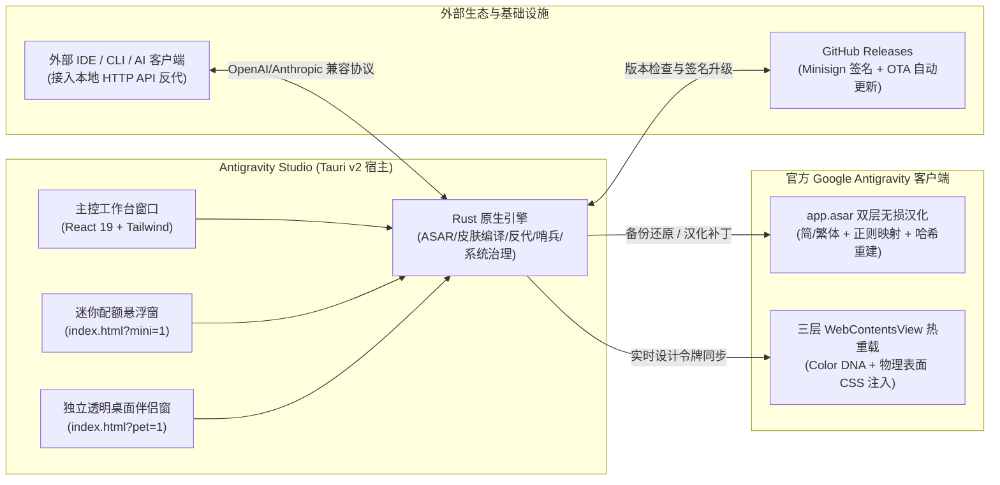

<div align="center">

# Antigravity Studio

**基于 Tauri v2 + React 19 + Rust 构建的新一代 Antigravity 全能中文控制中心与光学美学引擎**

[](https://github.com/qts2218346424-cyber/antigravity-zh-cn/actions/workflows/release.yml)
[](https://github.com/qts2218346424-cyber/antigravity-zh-cn/releases)
[](src-tauri/tauri.conf.json)
[](LICENSE)


**多账号配额调度 · 本地 API 反代 · 客户端双层无损汉化 · 高定光学材质引擎 · 极速系统治理 · 独立透明桌面伴侣 · OTA 签名推送**

[📥 下载与快速上手](#-下载与三步快速上手) · [✨ 九大工作台矩阵](#-九大工作台与核心能力矩阵) · [🏗️ 系统架构](#️-系统架构全景) · [🎨 高定光学材质](#-高定光学材质包系统) · [🈶 汉化与哨兵](#-全量无损汉化与哨兵守护) · [🪐 桌面伴侣](#-独立灵动桌面伴侣) · [🛠️ 开发与发布](#️-本地开发与编译) · [❓ 常见问题](#-常见问题与排查-faq)

</div>

---

> [!NOTE]
> **原生桌面内核全面架构**：`Antigravity Studio` 彻底告别早期零散批处理与内置脚本注入方案，以高性能 Rust 原生内核统一集成「多账号配额管理」、「本地 HTTP API 反代」、「Antigravity 全量无损汉化」、「双端光学材质热重载引擎」、「系统进程压榨治理」与「独立透明桌面伴侣」，并通过 GitHub Actions 自动构建、Minisign 数字签名与 OTA 流水线向全平台持续分发更新。

---

## 📥 下载与三步快速上手

### 1. 下载对应平台安装包

前往 [**GitHub Releases 发布页**](https://github.com/qts2218346424-cyber/antigravity-zh-cn/releases) 下载适合您系统的最新版安装包：

| 操作系统 | 推荐安装包格式 | 说明 |
| :--- | :--- | :--- |
| **Windows (x64)** | `*_x64-setup.exe` / `*_x64_en-US.msi` | NSIS 一键安装版（推荐）或 MSI 安装包；支持应用内 OTA 自动更新 |
| **macOS (Apple Silicon / Intel)** | `*.dmg` / Universal `.app` | 通用架构包，原生适配 M 系列与 Intel 芯片 |
| **Linux (x64)** | `*.deb` / `*.rpm` / `*.AppImage` | 覆盖 Debian/Ubuntu、Fedora/RHEL 与便携 AppImage |

### 2. 三步开启完整体验

1. **① 一键客户端汉化**：打开顶栏 **「汉化与美化 → 全量汉化引擎」**，工具将自动探测官方 `Antigravity` 安装路径，备份原始 `app.asar` 后执行无损汉化，并可一键汉化本地扩展与全局规则。
2. **② 切换高定光学材质**：进入 **「光学材质画廊」** 预览 10 款 1:1 微缩主题（含《CLANNAD》四重奏典藏皮肤），点击即可即时热重载同步至已打开的客户端窗口。
3. **③ 配置调度、提速与桌面伴侣**：在 **「账号管理 / API 反代」** 统一调度多账号额度；按需使用 **「极速压榨与治理」** 一键 UAC 提权释放内存与缓存；或点击顶部右侧 **小猫按钮** 呼出独立透明桌面伴侣。

---

## ✨ 九大工作台与核心能力矩阵

顶部导航采用**智能阶梯响应式架构**：在标准桌面窗口（`640px - 1239px`）自动启用**智能聚焦胶囊**（激活模块展开图文标识、其余呈现精致图标，杜绝内容截断与图标遮挡），在 `≥ 1240px` 宽屏下自动舒展展示全文字导航；另提供一键切换 **迷你悬浮窗（Mini View）** 方便常驻角落盯防额度。

### 核心工作台模块

| 导航板块 | 源码位置 | 核心职责与关键能力 |
| :--- | :--- | :--- |
| 📊 **仪表盘** | [`Dashboard.tsx`](src/pages/Dashboard.tsx) | 全局配额健康度总览、账号配额实时监控、快捷反代状态与关键指标聚合卡片 |
| 👥 **账号管理** | [`Accounts.tsx`](src/pages/Accounts.tsx) | 多账号 OAuth 授权登录 / Token 导入导出、刷新校验与智能“蹬额度”自动切换策略 |
| 🌐 **API 反代** | [`ApiProxy.tsx`](src/pages/ApiProxy.tsx) | 高性能本地 HTTP API 代理网关、模型路由映射、请求并发调度与多客户端接入支持 |
| 📈 **流量日志** | [`Monitor.tsx`](src/pages/Monitor.tsx) | 实时请求调用流水监控、延迟/状态码追踪、请求/响应负载详情排查 |
| 📉 **Token 统计** | [`TokenStats.tsx`](src/pages/TokenStats.tsx) | 多维度 Token 消耗走势图、分模型/分账号成本与吞吐量统计报表 |
| 🔑 **访问令牌** | [`UserToken.tsx`](src/pages/UserToken.tsx) | 多租户/多客户端独立访问 Key 签发、额度限制与细粒度用量监控 |
| 🔒 **IP 安全管理** | [`Security.tsx`](src/pages/Security.tsx) | 本地代理访问控制、IP 黑白名单策略配置与异常请求拦截审计 |
| ✨ **汉化与美化** | [`Studio/index.tsx`](src/pages/Studio/index.tsx) | 集成 **8 大专属子工坊** 的桌面体验改造与系统治理中枢（详见下表） |
| ⚙️ **全局设置** | [`Settings.tsx`](src/pages/Settings.tsx) | 深浅主题切换（View Transition 圆形扩散动画）、多语言切换、导航定制与 OTA 检查更新 |

### 「汉化与美化」8 大子工坊

| 子工坊名称 | 源码模块 | 核心功能亮点 |
| :--- | :--- | :--- |
| 🎨 **光学材质画廊** | [`SkinGalleryTab.tsx`](src/pages/Studio/SkinGalleryTab.tsx) | 10 款高定主题 1:1 微缩客户端实时预览、一键应用与 `.zip` 皮肤包导入/导出 |
| 🎬 **启动动画剧场** | [`SplashTab.tsx`](src/pages/Studio/SplashTab.tsx) | 《CLANNAD》四大名场面剧照与 4 首原动画真曲音源、黄金副歌快跳及本地媒体导入 |
| 🧪 **色彩与材质实验室** | [`CustomizerTab.tsx`](src/pages/Studio/CustomizerTab.tsx) | **Color DNA** 实时调色与 6 项物理光学表面滑块编辑、主题派生与实时预览 |
| 🈶 **全量汉化引擎** | [`L10nTab.tsx`](src/pages/Studio/L10nTab.tsx) | `app.asar` 原生解包与 SHA-256 Integrity 重建、扩展与智能体描述翻译、防官方静默更新与旧宠物残余清理 |
| 🪐 **全明星桌面伴侣** | [`PetAndWatchdogTab.tsx`](src/pages/Studio/PetAndWatchdogTab.tsx) | 7 角色生态管理、22 条离线原生动漫语音试听点播台与伴侣物理/静音行为控制 |
| ⚡ **极速压榨与治理** | [`OptimizerTab.tsx`](src/pages/Studio/OptimizerTab.tsx) | 一键 UAC 提权执行进程优先级调度、内存工作集瘦身、临时缓存清理与硬件/网络环境压榨优化 |
| 🛡️ **自动维护哨兵** | [`PetAndWatchdogTab.tsx`](src/pages/Studio/PetAndWatchdogTab.tsx) | 后台 Tokio 守护线程实时巡检客户端哈希变动，官方更新后在空闲时自动静默重注汉化与材质 |
| 🔬 **全链路测试台** | [`DiagnosticsTab.tsx`](src/pages/Studio/DiagnosticsTab.tsx) | 一键巡检词典完整性、材质编译器、骨骼缓存、路径探测与反代连通性，内置伴侣动作与音效沙盒 |

---

## 🏗️ 系统架构全景



---

## 🎨 高定光学材质包系统

材质系统以「**Color DNA 配色变量 + `surfaces` 物理表面光学参数**」双轮驱动，编译器支持圆角 `radius`、磨玻璃模糊 `glass_blur`、卡片通透度 `card_opacity`、边缘辉光 `border_glow`、胶片噪点 `noise_grain` 与阴影景深 `shadow_elevation`，精准对接官方 `Antigravity` 应用三层 `WebContentsView` 架构（避让内置浏览器视口且彻底免除 `FSWatcher EPERM` 崩溃）。

所有内置主题清单位于 [`resources/skins/`](resources/skins)：

| 主题 ID | 风格定位 | 视觉与光学特征 |
| :--- | :--- | :--- |
| **`obsidian-glass`** | 黑曜石磨玻璃（默认） | 深邃暗曜对话画布配合 20px 磨玻璃高斯模糊与细腻噪点纹理，夜间推演首选 |
| **`vermilion-lacquer`** | 东方朱漆美学 | 漆器朱红与鎏金对比色板、低饱和通透卡片层与柔和金属高光描边 |
| **`nordic-aurora`** | 北境极光玻璃 | 冷冽极光蓝绿梯度光晕叠加扩散投影，打造克制通透的北欧极简观感 |
| **`nezuko-bamboo`** | 祢豆子竹林和风 | 会话侧栏麻叶织纹视觉基底与绯樱竹翠撞色体系 |
| **`sakura-light`** | 樱雪晴空浅色 | 清透高亮日间色板、矢量樱瓣质感与柔和玻璃边线 |
| **`midnight-dark`** | 午夜星尘深空 | 深空星海高对比对话阅读色域与静谧夜空氛围 |
| **`clannad-sakura-hill`** | CLANNAD · 光坂坡道与团子 | 春季奶油樱白浅色画布、柔粉樱花微光卡片与右下角微笑团子大家族暗纹 |
| **`clannad-illusionary-orbs`** | CLANNAD · 幻想世界光玉 | 深宵苍穹蓝黑画布、奇迹暖金与冰蓝光玉微光、22px 液态亚克力思考卡折射 |
| **`clannad-after-sunflower`** | CLANNAD · 汐与晴空花田 | 盛夏麦穗米白护眼画布、向日葵琥珀金高光与澄澈晴空蓝微光点缀 |
| **`clannad-starfish-library`** | CLANNAD · 图书室海星与提琴 | 暮色紫檀深空对话底色、薰衣草提琴弦光与风子纪念木雕海星纹理 |

---

## 🈶 全量无损汉化与哨兵守护

- **全量词典与安全边界**：内置 **4,840+ 词条**与长描述省略号截断容错引擎，覆盖 `zh-CN` / `zh-TW` / `zh-HK`，完整覆盖菜单/托盘、插件市场、思考等级与音频设备、自动化计划、自定义智能体、SSH 远程主机与第三方声明，同时精确避让代码块与终端交互区，并完整保留官方原版 `dist/loadingOverlay.js` 秒开启动体验。
- **备份保障与一键还原**：首次汉化前自动将原版 `app.asar` 备份为 `app.asar.bak`，随时支持 100% 无损恢复官方原版；同时内置早期旧脚本残留宠物代码（`__AGY_NEZUKO_PET_INITIALIZED__`）的自动侦测与一键清扫。
- **生态规则与防覆盖**：支持批量翻译 `~/.gemini` 下插件技能 `SKILL.md` 及智能体描述（保留多行 YAML 无损结构）、写入全中文深度思考协议至 `~/.gemini/GEMINI.md`，并可管理官方 `app-update.yml` 自动更新状态。

---

## 🪐 独立灵动桌面伴侣

桌面伴侣（[`PetWindowView.tsx`](src/components/pet/PetWindowView.tsx)、[`petLogic.ts`](src/components/pet/petLogic.ts)）运行在独立透明无边框窗口，与官方客户端进程彻底解耦：

- **7 角色生态与自定义热导入**：内置 **灶门祢豆子（8 态原画与 3D 大正木箱）**、**B612 小王子（经典绘本星海玫瑰六姿态）**、**冈崎汐 & 团子大家族**、**灶门炭治郎**、**我妻善逸**、**嘴平伊之助** 6 大角色，并支持一键导入本地透明 PNG / WebP / GIF / SVG 自定义形象。
- **22 条离线动漫原生语音与点播台**：内嵌《CLANNAD》冈崎汐、鬼杀队日语原声与 B612 小王子纯正法语独白，支持动作交互联动、对白气泡循环及主界面试听（自主漫步期间默认静默免打扰）。
- **物理弹簧曲线与灵动交互坞**：采用 CSS `linear()` 弹簧动力学（遵循系统 `prefers-reduced-motion` 设置）与 `5px` 位移物理防抖，兼顾单击摸头、双击绝技与任务栏安全拖拽；内置上下自动隐藏灵动面板、低配额预警气泡与悬浮舱内一键切号、12 组 WebAudio 合成音效及二分查找毫秒级 LRC 歌词同步舱。

---

## 🛠️ 本地开发与编译

### 环境要求
- **Node.js** `>= 20`（推荐 `22`）
- **Rust** `>= 1.77`（`rustup` / `cargo`）
- **系统构建依赖**：
  - Windows：Visual Studio C++ 构建工具 + WebView2
  - macOS：Xcode Command Line Tools
  - Linux：`libwebkit2gtk-4.1-dev`、`libappindicator3-dev`、`librsvg2-dev`、`patchelf`

### 常用开发命令

```bash
# 安装前端依赖
npm ci

# 启动 Web 前端预览模式（默认 http://localhost:1420）
npm run dev

# 执行 TypeScript 静态类型检查
npm run typecheck

# 运行全套自动化单元测试（共 11 个测试套件）
npm test

# 构建前端生产包 (tsc && vite build)
npm run build

# 启动完整 Tauri v2 桌面端开发调试
npm run tauri dev

# 打包当前系统桌面端安装包
npm run tauri build
```

### OTA 版本同步与发布流水线

仓库通过 [`.github/workflows/release.yml`](.github/workflows/release.yml) 在推送 `v*` 标签后自动执行前端测试校验、三端原生打包与 Minisign 签名分发，并在全平台产物就绪后自动由 `Pre-release` 切换为正式 `Latest` 版本：

```bash
# 1. 统一递增 package.json / package-lock.json / Cargo.toml / Cargo.lock / tauri.conf.json / README.md 版本号
node scripts/bump-version.mjs 5.9.0

# 2. 执行单元测试、类型校验与生产打包
npm test
npm run typecheck
npm run build

# 3. 提交并推送版本标签以触发全平台构建与 OTA 发布
git add -A
git commit -m "chore: 发布 v5.9.0"
git tag v5.9.0
git push origin main v5.9.0
```

---

## 📂 工程目录结构

```text
antigravity-zh-cn/
├── .github/workflows/
│   └── release.yml                # 多平台 Tauri 自动构建、Minisign 签名与 OTA 发布流水线
├── resources/
│   ├── skins/                     # 10 款内置高定光学材质主题包（含 CLANNAD 四重奏）
│   ├── media/                     # 伴侣多姿态透明原画、启动剧照/音频与 voices/ 离线原生语音库
│   ├── antigravity-zh-*.json      # 简/繁体双语全量词典 (4,840+ 词条)
│   ├── rules-zh-CN.json           # 动态正则汉化规则库
│   ├── desktop-zh-CN.json         # 客户端主进程菜单与托盘汉化字典
│   ├── runtime-zh.js              # 渲染层高性能 DOM 汉化运行时
│   └── skin-runtime.js            # 客户端与三层 WebContentsView 光学皮肤热重载脚本
├── scripts/
│   ├── bump-version.mjs           # 多端版本号与 README 示例一键同步工具
│   └── run-tests.mjs              # 零外部依赖自动化单元测试执行器
├── src/                           # React 19 + TypeScript + Tailwind v4 前端源码
│   ├── components/
│   │   ├── navbar/                # 智能阶梯聚焦胶囊顶部导航栏 (Navbar / NavMenu / NavLogo / NavSettings)
│   │   ├── pet/                   # 独立透明桌面伴侣窗口视图与物理/歌词逻辑
│   │   ├── proxy/                 # API 反代管理与监控卡片组件
│   │   └── common/                # 通用高质感 UI 组件与弹窗
│   ├── pages/
│   │   ├── Dashboard.tsx          # 仪表盘
│   │   ├── Accounts.tsx           # 账号管理与配额调度
│   │   ├── ApiProxy.tsx           # 本地 API 反代网关
│   │   ├── Monitor.tsx            # 流量日志监控
│   │   ├── TokenStats.tsx         # Token 用量统计
│   │   ├── UserToken.tsx          # 访问令牌管理
│   │   ├── Security.tsx           # IP 安全与访问控制
│   │   ├── Settings.tsx           # 全局设置与主题切换
│   │   └── Studio/                # 汉化与美化控制中心（8 大专属子工坊）
│   └── services/studioService.ts  # Tauri IPC 调用封装
└── src-tauri/                     # Rust 后端与 Tauri v2 宿主核心
    ├── tauri.conf.json            # 主窗/迷你窗/伴侣窗策略、资源映射与 OTA Updater 配置
    └── src/modules/
        ├── studio/                # ASAR 解包重建、汉化引擎、皮肤编译器、伴侣状态、系统压榨治理与哨兵
        └── ...                    # 账号调度、OAuth、HTTP 反代网关、安全与统计持久化模块
```

---

## ❓ 常见问题与排查 (FAQ)

<details>
<summary><b>1. 官方 Antigravity 更新后，汉化或主题失效了怎么办？</b></summary>

- 开启 **「汉化与美化 → 自动维护哨兵」** 后，后台守护线程会在官方更新覆盖文件且客户端空闲时自动静默重新注入；也可直接在 **「全量汉化引擎」** 点击一键重新注入，或在右上角开启禁止官方静默覆盖（修改 `app-update.yml`）。

</details>

<details>
<summary><b>2. Windows 安装在系统目录（如 Program Files）时提示写入权限不足？</b></summary>

- 请在弹窗提示时允许 **UAC 管理员提权**，或在 **「汉化与美化 → 极速压榨与治理」** 中使用内置的一键 UAC 提权功能以管理员权限完成写入与进程优化。

</details>

<details>
<summary><b>3. 如何完整、无损地还原到官方原版 Antigravity？</b></summary>

- 在 **「汉化与美化 → 全量汉化引擎」** 中点击 **「还原官方原版」**，程序会自动将首次备份的 `app.asar.bak` 完整恢复并清理附加样式脚本。

</details>

<details>
<summary><b>4. 为什么刚发布新版本时 GitHub Releases 页面暂时显示为 Pre-release（预发布）？</b></summary>

- 因为云端流水线需要并发编译 Windows、Linux 与 macOS（双架构约 25-30 分钟）安装包。为避免客户机在 macOS 尚未上传完毕时拉取到残缺清单，流水线在构建过程中会先标记为 `Pre-release`；待三端文件全部就绪后会自动切换为正式 `Latest`。Windows / Linux 安装包只要显示已上传即可直接下载使用，与最终正式版完全一致。

</details>

---

<div align="center">

基于 [MIT License](LICENSE) 开源 · **Antigravity Studio**

</div>
